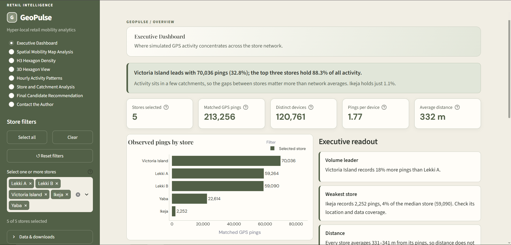
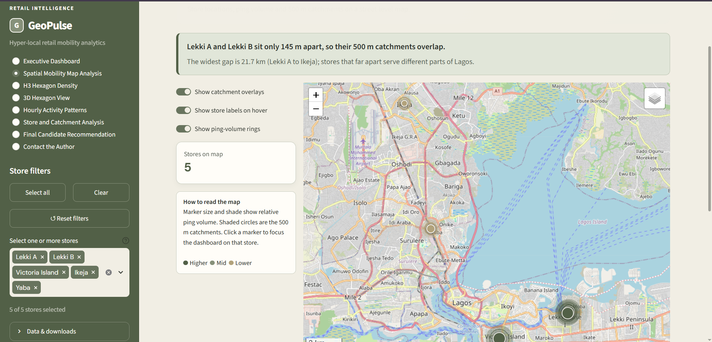
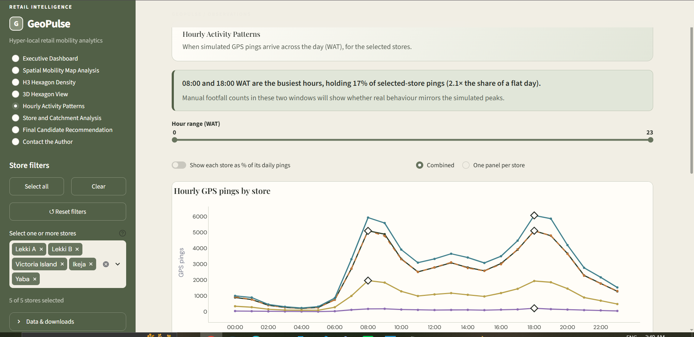
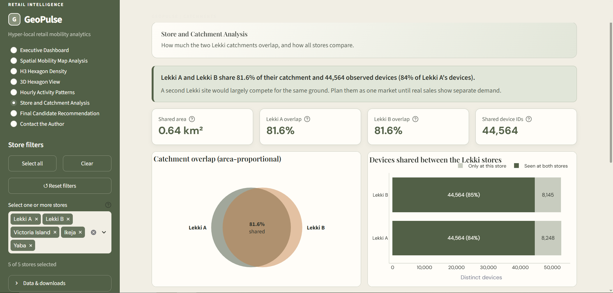

# GeoPulse: Store Catchment & Mobility Analytics for Lagos

GeoPulse explores a practical retail question: **if two stores sit close together, how much of the same ground do they actually serve?**

I built it around five store locations in Lagos (Lekki A, Lekki B, Victoria Island, Ikeja and Yaba) and about 10 million GPS pings. Each store gets a 500 m catchment. The pings that fall inside those catchments are matched to stores in BigQuery, summarised, and explored in a Streamlit dashboard with maps, hourly charts, H3 hexagons and a 3D view.

## Dashboard Preview

<!-- Add a short dashboard GIF here after recording it. -->

*Interactive dashboard preview coming soon.*

**Project resources:** [Live Dashboard — Coming Soon](#project-status) · [PDF Project Report — Coming Soon](#project-resources) · [Project Design Plan](docs/project_blueprint.md)

## Data Sources

| Source | Rows | Notes |
|---|---:|---|
| Synthetic GPS pings | 10,000,000 | Simulated location observations; not actual customer visits |
| Spatially enriched GPS pings | 10,000,000 | Ping records prepared for geospatial analysis |
| `store_catchments` | 213,256 | Ping-to-store matches within the modelled 500 m catchments; a ping can match more than one store |

## What the dashboard shows

With the current data, the dashboard surfaces these findings:

Activity is concentrated. Victoria Island leads with 70,036 matched pings (32.8%), and the top three stores hold 88.3% of the 213,256 matched pings. Ikeja holds just 1.1%.
The two Lekki stores are close to one market. Their catchments overlap by 81.6%, and 44,564 devices appear in both (84% of Lekki A's devices).
The day has two peaks. Pings cluster around 08:00 and 18:00 WAT, and those two hours hold about 17% of all activity.
Distance doesn't separate the stores. Average ping-to-store distance is 331 to 341 m everywhere, so volume and overlap tell the story.
A few hexagons carry the load. At H3 resolution 9, 11 of 69 hexagons hold half of all matched pings.

## Dashboard Screenshots

<table>
  <tr>
    <td width="50%"></td>
    <td width="50%"></td>
  </tr>
  <tr>
    <td width="50%"></td>
    <td width="50%"></td>
  </tr>
</table>

## The pages

| Page | What it's for |
|---|---|
| **Executive Dashboard** | Store ranking, headline KPIs and a short readout. Click a bar to focus the whole dashboard on one store. |
| **Spatial Mobility Map Analysis** | Store markers that pulse with activity, 500 m catchments and ping-volume rings on a street map. |
| **H3 Hexagon Density** | Matched pings grouped into H3 hexagons (resolution 8 or 9), with a "Zoom to" control and a check that hexagon totals match the store table. |
| **3D Hexagon View** | The same hexagons as towers, with height set by ping count. Tilt, rotate and stretch them. |
| **Hourly Activity Patterns** | Pings by hour of day, per store or combined, with peak hours marked. |
| **Store and Catchment Analysis** | The Lekki overlap shown as an area-proportional diagram, plus how many devices the two stores share. |
| **Final Candidate Recommendation** | An illustrative store score (ping volume against distance, with an adjustable weight), the hotspot hexagons to check first, and an action plan. |
| **Contact the Author** | Links and contact details. |

## How it's built

1. **Source data:** a simulated GPS ping file, store locations and 500 m catchment polygons, loaded into BigQuery (dataset in `africa-south1`).
2. **Matching:** pings inside a store's catchment are stored in `store_catchments` with their distance to the store.
3. **Summary table:** a mart table (`mart_store_catchment_summary`) holds pings, devices and average distance per store, and feeds the dashboard.
4. **H3 assignment:** BigQuery has no H3 library in `africa-south1`, so the dashboard reads ping coordinates from BigQuery and assigns each ping's H3 cell with the Python `h3` package. Hexagon counts are checked against the store table on every load.
5. **Dashboard:** Streamlit, with Folium for 2D maps, pydeck for the 3D view and Plotly for charts.

## Technology Stack

| Technology | Purpose |
|---|---|
| Python | Synthetic data generation and dashboard application |
| Pandas | Data preparation for dashboard visualizations |
| Google BigQuery | Data storage, SQL analytics, and geospatial processing |
| BigQuery GEOGRAPHY | Store locations, catchment polygons, and spatial operations |
| SQL | Catchment matching, hourly aggregation, and polygon overlap |
| dbt | Staging and analytical modelling |
| Streamlit | Interactive dashboard |
| Folium | Interactive store map and catchment polygons |
| Plotly | Interactive charts |
| Git and GitHub | Version control and project collaboration |

## Run it locally

You need Python, a Google Cloud project with the GeoPulse BigQuery tables, and Streamlit 1.50 or newer.

```bash
py -m pip install streamlit pandas plotly folium streamlit-folium pydeck google-cloud-bigquery h3
gcloud auth application-default login
py -m streamlit run dashboard/app.py
```

Useful settings (all optional):

| Setting | Purpose |
|---|---|
| `GEOPULSE_PROJECT_ID` | Your Google Cloud project ID |
| `GEOPULSE_PING_TABLE` | Raw GPS table with ping coordinates, if automatic detection picks the wrong one |

The full-dataset download in the sidebar expects the ping file at `data/raw/gps_pings.csv.gz`. A `.streamlit/config.toml` sets the theme and a minimal toolbar.

## Status

| Part | Status |
|---|---|
| BigQuery tables and the dashboard (all 8 pages) | Working |
| H3 hexagons and 3D view | Working, matched to the store table |
| Daily Airflow pipeline (load, transform, refresh the mart) | Drafted, not yet deployed or tested |
| Automated tests | Not yet added |

## Limitations

- Pings are observations, not visitors. A ping inside both Lekki catchments counts once per store, as it does in the store table.
- Catchments are fixed 500 m circles, a modelling choice and not a travel-time boundary.
- Overlap is geometry. It does not show customers switching or sales being lost.
- A hexagon's density shows pings, not footfall. Tower height is ping count and nothing else.
- The candidate score uses only ping volume and distance. Because distances differ by about 9 m, distance is scored as neutral instead of inflating the gap.
- A real site decision would need footfall counts, rents, demographics, access, competitors and actual sales.

## Project Resources

- **Project Design Plan:** [Read the blueprint](docs/project_blueprint.md)
- **PDF Project Report:** Coming soon
- **Live Dashboard:** Not deployed yet

## Next steps

- Deploy and test the daily Airflow pipeline so the dashboard's "Data refreshed" time comes from real runs.
- Add automated tests for the scoring, overlap and hexagon calculations.
- Add data-quality checks to the load.
- Swap in real business data when it is available.

## Contact

Lawrence Ruth: lawrenceruth34@gmail.com · [LinkedIn](https://www.linkedin.com/in/ruth-lawrence-8519073b7) · [GitHub](https://github.com/lawrenceruth)

*GeoPulse is a portfolio project for learning and demonstration. Its results should not be read as commercial evidence.*